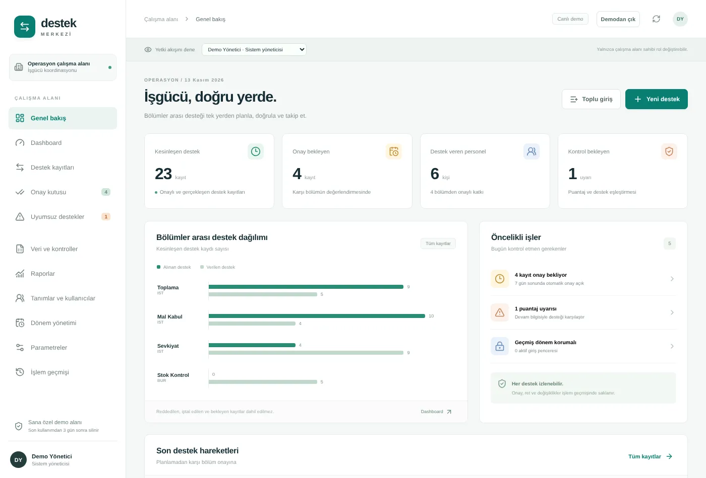
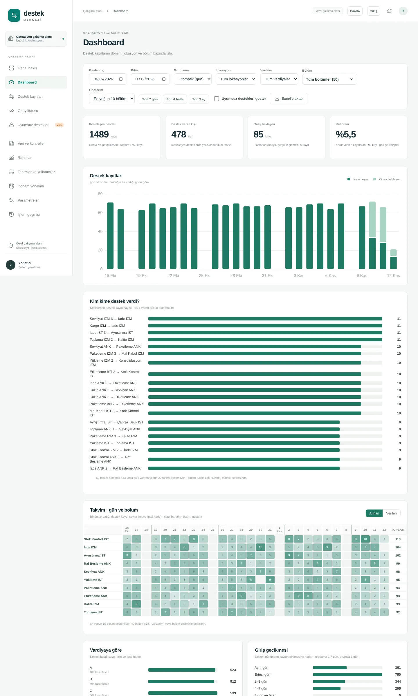
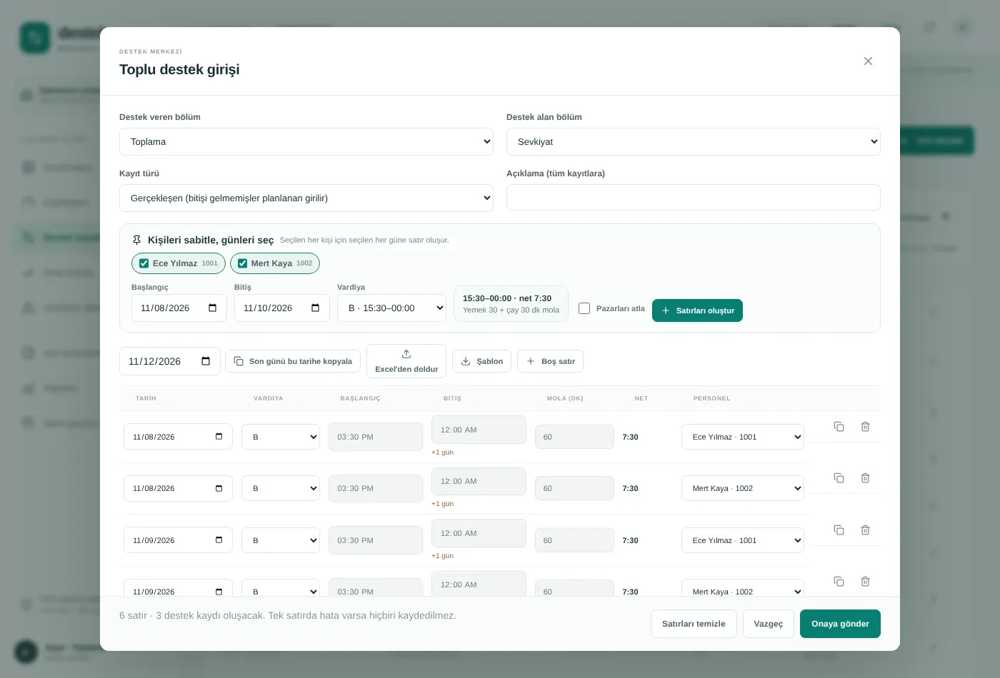
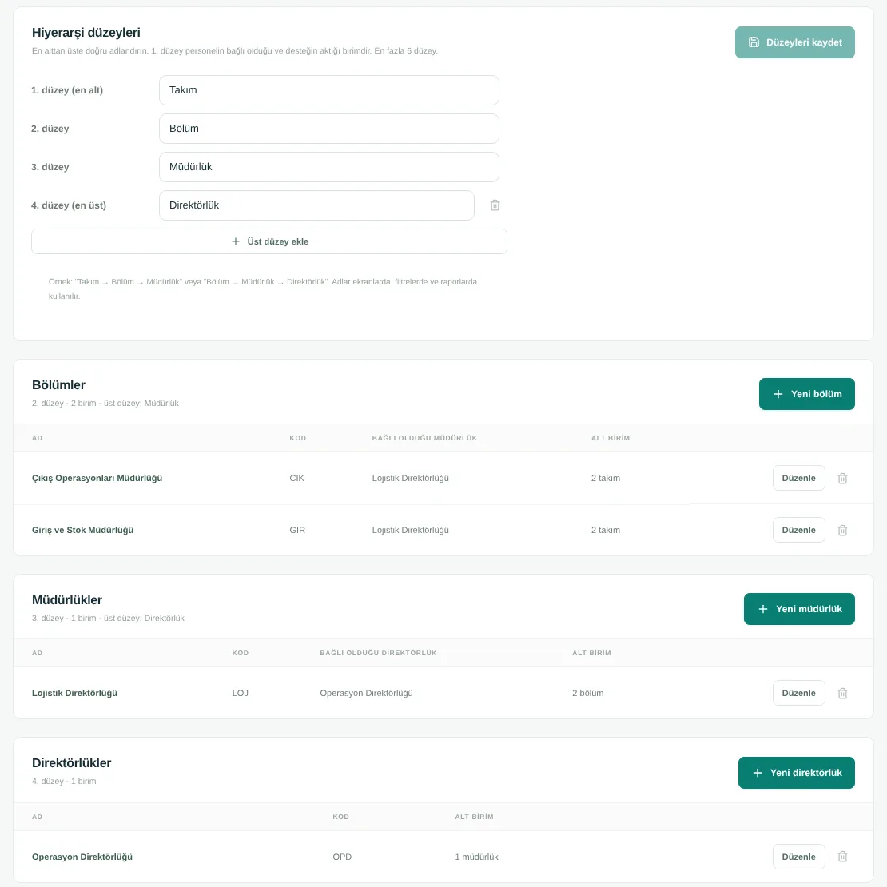

# Destek Merkezi

Bölümler arası işgücü desteğini kaydeden, karşı bölüme onaylatan ve puantajla karşılaştıran Türkçe bir operasyon uygulaması. Depo ve üretim gibi vardiyalı işletmeler için tasarlandı: destek talebi genelde WhatsApp'tan gelir, kayıt günün sonunda, ertesi gün ya da sonraki hafta girilir. Program bu gerçeğe göre kurgulandı.

**Canlı demo:** https://destek.ysfdurak.com — giriş gerekmez. Kurgusal bir depo organizasyonuyla dolu, yalnızca sana ait bir alan açılır ve son kullanımdan 3 gün sonra silinir.

**English:** https://destek.ysfdurak.com/?lang=en — the whole interface and the demo data open in English (sidebar button to switch back). Nasıl çalıştığı: [docs/CEVIRI.md](docs/CEVIRI.md).



## Neler yapar

| Alan | İçerik |
|---|---|
| Destek kaydı | Veren ve alan bölüm, kişiler, tarih. Vardiyalı destekte saat ve mola vardiyadan gelir (A/B/C, yemek ve çay molası; 8:30 vardiya − 1 saat mola = 7:30 destek). |
| Toplu giriş | Kişileri sabitle, birkaç günü tek seferde gir, son günü kopyala, Excel'den doldur. |
| Onay | Karşı bölüm onaylar veya gerekçeyle reddeder. Süre dolunca otomatik onay seçilebilir. Gönderen kaydı geri çekebilir. |
| Kontroller | Bir kişiye aynı tarihte ikinci kayıt girilemez. Puantajla karşılaştırma yapılır: o gün gelmeyen, çalıştığından fazla destek yazılan ya da vardiya dışında kalan kişiler "uyumsuz destek" ekranına düşer ve oradan incelenip iptal edilebilir. |
| Geriye dönük giriş | Kaç gün geriye kayıt girilebileceği ve haftalık kapanış parametreyle belirlenir. Geçmiş dönem yönetici onayıyla açılır. |
| Hiyerarşi | Düzey adlarını ve derinliği işletme belirler: "Takım → Bölüm → Müdürlük" ya da "Bölüm → Müdürlük → Direktörlük", en fazla 6 düzey. |
| Dashboard | Kim kime destek verdi matrisi, gün × birim takvimi, vardiya, giriş gecikmesi ve onay süresi. Hiyerarşi düzeyine göre filtrelenir ve toplanır. 50+ bölümlük yerlerde okunur kalması için en yoğun N birimi gösterir ve aranabilir tablolar kullanır. |
| Rapor merkezi | Altı hazır rapor: Excel'e aktarılır, yazdırılır veya PDF yapılır. |
| Puantaj aktarımı | Excel'den aktarılır. Sütun ve durum kodu eşleştirilir, `07:30` ve `07;30` gibi yazımları da okur. |
| Yetki | Yönetici, bölüm yetkilisi ve rapor izleyicisi rolleri var. Her kullanıcı yalnızca kendi bölümlerini görür. |

Adam-saat ve verimlilik hesabı bilinçli olarak yok. Program yalnızca kayıt ve kişi sayılarıyla çalışır.

| | |
|---|---|
|  |  |
|  | |

## Teknik yapı

- **Sunucu:** Node.js 24, yalnızca yerleşik modüllerle çalışır (`node:sqlite`, `node:http`, `node:crypto`). Çalışırken `node_modules` gerekmez.
- **Veri:** SQLite. Günlük tutarlı yedek alınır (`VACUUM INTO`).
- **Arayüz:** React ve TypeScript, esbuild ile tek dosyaya derlenir. Excel okuma ve yazma tarayıcıda yapılır (SheetJS).
- **İş kuralları:** Tek bir çekirdekte durur: `lib/domain.mjs` → `applyAction`. Sunucu ve testler aynı kuralları kullanır.
- **Access istemcisi:** İsteğe bağlı bir Windows istemcisidir (`access/`). Aynı sunucuya bağlanır ve destek girişi ile onay yapar.

| Klasör | İçerik |
|---|---|
| `app/` | Arayüz |
| `lib/` | İş kuralları, dashboard, raporlar, hiyerarşi, Excel dönüştürme |
| `server/` | HTTP sunucusu, SQLite deposu, yedek, e-posta kuyruğu, ziyaretçi demo alanları |
| `tests/` | İş kuralı, sunucu ve demo testleri (`npm test`) |
| `deploy/` | Docker Compose ve Caddy örnekleri |
| `access/` | Microsoft Access istemcisi |
| `docs/` | Kurallar ve kararlar, değişiklikler ve kod rehberi, sunucu kurulumu |

## Çalıştırma

**Bilgisayarında denemek için:**

```bash
npm ci
npm run build
cp ayarlar.ornek.json ayarlar.json
npm start            # http://127.0.0.1:8732
```

İlk açılışta yönetici hesabı oluşturulur ve "Örnek verilerle dene" ya da "Boş çalışma alanı" seçilir. Windows'ta `Baslat.cmd` ile de başlatılabilir.

**Kurum içi Windows sunucusu:** [KURULUM.md](KURULUM.md). İşletme büyüklüğüne göre profiller var (küçük, orta, kurumsal). HTTPS ve Microsoft 365 e-posta bildirimleri de bu belgede anlatılıyor.

**Docker ve VPS:** [docs/SUNUCU_KURULUMU.md](docs/SUNUCU_KURULUMU.md). İki mod var: demo modu (portföy sitesi) ve kurum modu (tek şirket).

## Belgeler

- [Kurallar ve kararlar](docs/Kurallar_ve_Kararlar.md): iş kurallarının tek listesi
- [Değişiklikler ve kod rehberi](docs/DEGISIKLIKLER_VE_KOD_REHBERI.md): V1.1–V1.4'te ne değişti, hangi kural kodda nerede
- [Proje notu](docs/Isgucu_Destek_Yonetimi_Proje_Notu.md)
- [Access istemcisi kurulumu](access/ACCESS_KURULUM.md): istemci V1.1'de donduruldu; yeni özellikler yalnızca tarayıcı arayüzüne eklenir

## Test

```bash
npm run build && npm test
```

52 test şunları kapsar:

- oturum ve bölüm yetkisi
- destek, onay ve geri çekme akışı
- vardiya ve tekrar giriş kuralları
- hiyerarşi
- Excel dönüştürme
- yedek, profil ve parola
- e-posta kuyruğu
- demo alanlarının birbirinden ayrılması ve sınırları

GitHub Actions her gönderimde testleri çalıştırır, Docker imajını derler ve konteyneri demo modunda dener.

## English

**Destek Merkezi** (Support Centre) records inter-department workforce support in shift-based operations, gets each record approved by the receiving department and checks it against attendance. It is built for warehouses and plants where requests arrive over WhatsApp and records are entered days later.

- **Try it:** https://destek.ysfdurak.com/?lang=en — no sign-in; you get your own workspace with a fictional warehouse organisation in English, deleted 3 days after last use. The whole interface, reports and demo data are in English (sidebar button to switch back).
- **Features:** shift-based fixed durations, bulk and retroactive entry, same-day duplicate block, approval/rejection/withdrawal, mismatches with attendance, a hierarchy defined by the business (up to 6 levels), dashboard, six reports to Excel/PDF, attendance import from Excel, role-based access.
- **Stack:** Node.js 24 with built-in modules only (`node:sqlite`, `node:http`), SQLite, React + TypeScript bundled with esbuild, optional Microsoft Access client. Business rules live in one core (`lib/domain.mjs`).
- **Run locally:** `npm ci && npm run build && cp ayarlar.ornek.json ayarlar.json && npm start` → http://127.0.0.1:8732. Server set-up: [KURULUM.md](KURULUM.md) (Windows) and [docs/SUNUCU_KURULUMU.md](docs/SUNUCU_KURULUMU.md) (Docker / VPS).
- **Tests:** `npm run build && npm test` (52 tests).

## Bilinen konular

- `xlsx` npm paketi 0.18.5 sürümünde. Bu sürümde, özel hazırlanmış bir Excel dosyası açıldığında etkili olan bilinen açıklar var. Dosya yalnızca kullanıcının kendi tarayıcısında okunur, sunucuya Excel gitmez. Güncel sürüm yalnızca SheetJS'in kendi adresinden kurulabiliyor: `npm install https://cdn.sheetjs.com/xlsx-0.20.3/xlsx-0.20.3.tgz`.
- Yetkiler 1. düzey birimlere (ör. bölüm) verilir. Müdürlük düzeyinde yetki henüz yok.

Bağımlılıkların lisans metinleri `lisanslar/` klasöründedir.
